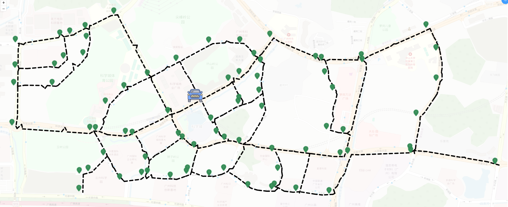
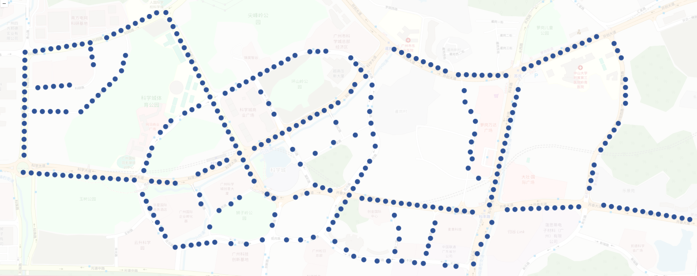
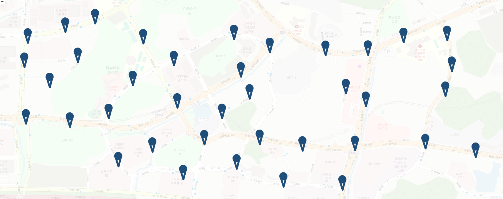

# TWSN Road-Network Dataset (JSON Format)

Welcome to the TWSN Road-Network Dataset repository! This dataset collection is curated for research on UAV-based wireless charging scheduling in Traffic Wireless Sensor Networks (TWSN). Each dataset contains a complete road network with intersections, sensors, relays, and a charging station. The data is provided in **JSON format**, with coordinates converted to a Cartesian coordinate system (meters) for easy distance computation.

## Description

The datasets are derived from **real-world GIS road networks** (RN series) and **realistic large-scale simulations** (SN series). They include:
- Road intersections as graph nodes
- Sensor nodes that may require charging
- Relay nodes that can also serve as charging points
- One charging station as the energy source
- Road segments as edges with length in meters

All coordinates are given in a **local Cartesian plane (meters)** after conversion from WGS84, making path planning and distance calculations straightforward.

## Usage

You are free to use these datasets for academic, research, or commercial purposes. If you find them valuable, please cite our paper (see Citation section) and provide a link back to this repository.

## Dataset Details

| Dataset Name | Sensor Nodes | Relay Nodes | Stations | Intersections | Data Format | File Name | Coordinate System |
|--------------|--------------|-------------|----------|---------------|-------------|-----------|-------------------|
| RN373        | 335          | 38          | 1        | 80            | JSON        | RN373.json | Cartesian (meters) |
| RN446        | 400          | 46          | 1        | 84            | JSON        | RN446.json | Cartesian (meters) |
| RN528        | 473          | 55          | 1        | 92            | JSON        | RN528.json | Cartesian (meters) |
| RN629        | 565          | 64         | 1        | 105           | JSON        | RN629.json | Cartesian (meters) |
| SN660        | 496         | 164         | 1        | 100           | JSON        | SN660.json | Cartesian (meters) |
| SN807        | 605         | 202         | 1        | 121           | JSON        | SN807.json | Cartesian (meters) |
| SN1099       | 824         | 275         | 1        | 169           | JSON        | SN1099.json| Cartesian (meters) |
| SN1540       | 1153         | 387         | 1        | 225           | JSON        | SN1540.json| Cartesian (meters) |

### RN373 Dataset
- Number of sensor nodes: 335
- Number of relay nodes: 38
- Number of stations: 1
- Number of intersections: 80
- Data format: JSON
- File: `RN373.json`
- Coordinate System: Cartesian (meters), converted from WGS84

<div align="center">
  
  <br>
  <em>Figure 3: RN373 Road Network Topology.</em>
</div>

<div align="center">
  
  <br>
  <em>Figure 4: RN373 Sensor Distribution Diagram.</em>
</div>

<div align="center">
  
  <br>
  <em>Figure 5: RN373 Relay Distribution Diagram.</em>
</div>

### RN446 Dataset
- Number of sensor nodes: 400
- Number of relay nodes: 46
- Number of stations: 1
- Number of intersections: 80
- Data format: JSON
- File: `RN446.json`
- Coordinate System: Cartesian (meters), converted from WGS84

### RN528 Dataset
- Number of sensor nodes: 473
- Number of relay nodes: 72
- Number of stations: 1
- Number of intersections: 84
- Data format: JSON
- File: `RN528.json`
- Coordinate System: Cartesian (meters), converted from WGS84

### RN629 Dataset
- Number of sensor nodes: 565
- Number of relay nodes: 64
- Number of stations: 1
- Number of intersections: 92
- Data format: JSON
- File: `RN629.json`
- Coordinate System: Cartesian (meters), converted from WGS84

### SN660 Dataset
- Number of sensor nodes: 496
- Number of relay nodes: 164
- Number of stations: 1
- Number of intersections: 100
- Data format: JSON
- File: `SN660.json`
- Coordinate System: Cartesian (meters), simulated from urban grid

### SN807 Dataset
- Number of sensor nodes: 605
- Number of relay nodes: 202
- Number of stations: 1
- Number of intersections: 121
- Data format: JSON
- File: `SN807.json`
- Coordinate System: Cartesian (meters), simulated from urban grid

### SN1099 Dataset
- Number of sensor nodes: 824
- Number of relay nodes: 275
- Number of stations: 1
- Number of intersections: 169
- Data format: JSON
- File: `SN1099.json`
- Coordinate System: Cartesian (meters), simulated from urban grid

### SN1540 Dataset
- Number of sensor nodes: 1153
- Number of relay nodes: 387
- Number of stations: 1
- Number of intersections: 225
- Data format: JSON
- File: `SN1540.json`
- Coordinate System: Cartesian (meters), simulated from urban grid


## JSON File Structure

Each JSON file contains the following top-level fields:

```json
{
  "statistics": { ... },
  "unit": "meters",
  "coordinate_system": { ... },
  "nodes": [ ... ],
  "edges": [ ... ],
  "adjacency": { ... }
}