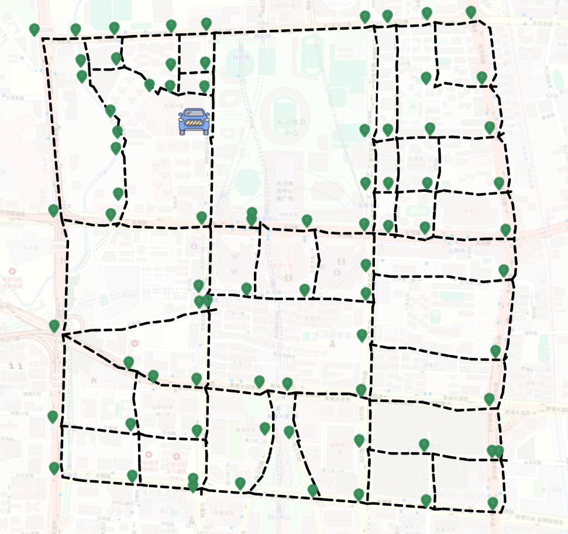
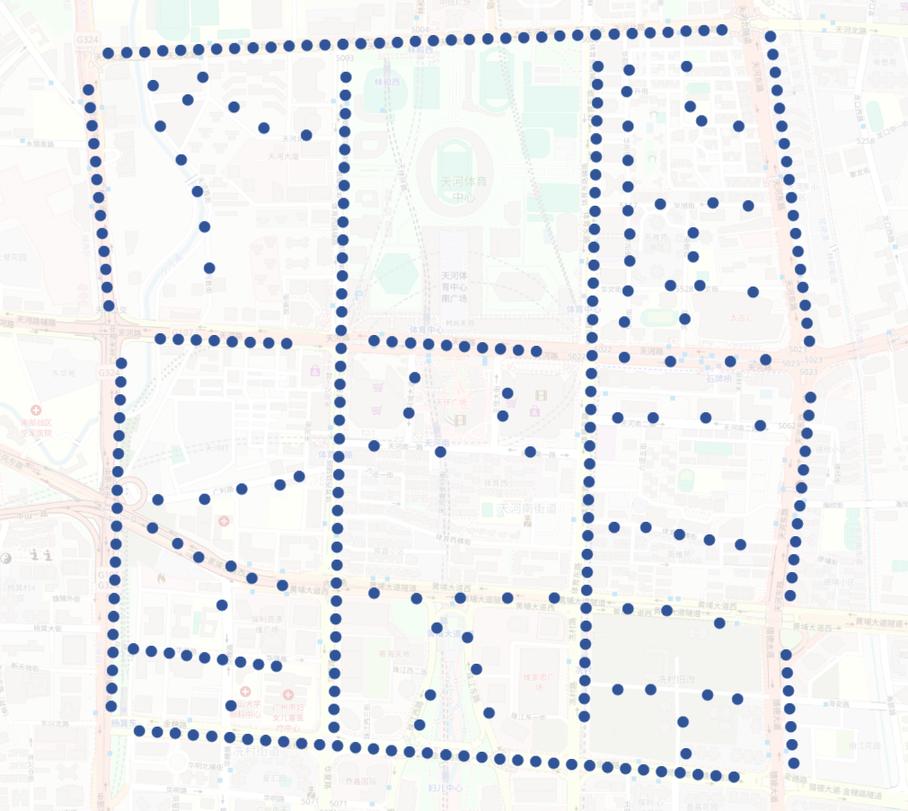

# TWSN Road-Network Dataset (JSON Format)

Welcome to the TWSN Road-Network Dataset repository! This dataset collection is curated for research on UAV-based wireless charging scheduling in Traffic Wireless Sensor Networks (TWSN). Each dataset contains a complete road network with intersections, sensors, relays, and a charging station. The data is provided in **JSON format**, with coordinates converted to a Cartesian coordinate system (meters) for easy distance computation.

## Description

The datasets are derived from **real-world GIS road networks** (RN series) and **realistic large-scale simulations** (SN series). They include:
- Road intersections as graph nodes
- Sensor nodes that may require charging
- Relay nodes that can also serve as charging points
- One charging station as the energy source
- Road segments as edges with length in meters

All coordinates are given in a **local Cartesian plane (meters)** after conversion from WGS84, making path planning and distance calculations straightforward.

## Usage

You are free to use these datasets for academic, research, or commercial purposes. If you find them valuable, please cite our paper (see Citation section) and provide a link back to this repository.

## Dataset Details

| Dataset Name | Sensor Nodes | Relay Nodes | Stations | Intersections | Data Format | File Name | Coordinate System |
|--------------|--------------|-------------|----------|---------------|-------------|-----------|-------------------|
| RN327        | 327          | -           | 1        | 80            | JSON        | RN327.json | Cartesian (meters) |
| RN335        | 335          | 38          | 1        | 80            | JSON        | RN335.json | Cartesian (meters) |
| RN422        | 422          | -           | 1        | 90            | JSON        | RN422.json | Cartesian (meters) |
| RN508        | 508          | 72          | 1        | 95            | JSON        | RN508.json | Cartesian (meters) |
| SN496        | 496          | 164         | 1        | 120           | JSON        | SN496.json | Cartesian (meters) |
| SN548        | 548          | -           | 1        | 130           | JSON        | SN548.json | Cartesian (meters) |
| SN824        | 824          | 275         | 1        | 160           | JSON        | SN824.json | Cartesian (meters) |
| SN928        | 928          | -           | 1        | 175           | JSON        | SN928.json | Cartesian (meters) |
| SN1153       | 1153         | 387         | 1        | 200           | JSON        | SN1153.json| Cartesian (meters) |
| SN1319       | 1319         | -           | 1        | 220           | JSON        | SN1319.json| Cartesian (meters) |

### RN327 Dataset
- Number of sensor nodes: 327
- Number of relay nodes: 0
- Number of stations: 1
- Number of intersections: 80
- Data format: JSON
- File: `RN327.json`
- Coordinate System: Cartesian (meters), converted from WGS84

<div align="center">
  
  <br>
  <em>Figure 1: RN327 Road Network Topology. Green dots represent road nodes, black lines indicate roads, and blue car icons mark autonomous vehicle service stations.</em>
</div>

<div align="center">
  
  <br>
  <em>Figure 2: RN327 Sensor Distribution Diagram.</em>
</div>

### RN335 Dataset
- Number of sensor nodes: 335
- Number of relay nodes: 38
- Number of stations: 1
- Number of intersections: 80
- Data format: JSON
- File: `RN335.json`
- Coordinate System: Cartesian (meters), converted from WGS84

<div align="center">
  
  <br>
  <em>Figure 3: RN335 Road Network Topology.</em>
</div>

<div align="center">
  
  <br>
  <em>Figure 4: RN335 Sensor Distribution Diagram.</em>
</div>

<div align="center">
  
  <br>
  <em>Figure 5: RN335 Relay Distribution Diagram.</em>
</div>

### RN422 Dataset
- Number of sensor nodes: 422
- Number of relay nodes: 0
- Number of stations: 1
- Number of intersections: 90
- Data format: JSON
- File: `RN422.json`
- Coordinate System: Cartesian (meters), converted from WGS84

### RN508 Dataset
- Number of sensor nodes: 508
- Number of relay nodes: 72
- Number of stations: 1
- Number of intersections: 95
- Data format: JSON
- File: `RN508.json`
- Coordinate System: Cartesian (meters), converted from WGS84

### SN496 Dataset
- Number of sensor nodes: 496
- Number of relay nodes: 164
- Number of stations: 1
- Number of intersections: 120
- Data format: JSON
- File: `SN496.json`
- Coordinate System: Cartesian (meters), simulated from urban grid

### SN548 Dataset
- Number of sensor nodes: 548
- Number of relay nodes: 0
- Number of stations: 1
- Number of intersections: 130
- Data format: JSON
- File: `SN548.json`
- Coordinate System: Cartesian (meters), simulated from urban grid

### SN824 Dataset
- Number of sensor nodes: 824
- Number of relay nodes: 275
- Number of stations: 1
- Number of intersections: 160
- Data format: JSON
- File: `SN824.json`
- Coordinate System: Cartesian (meters), simulated from urban grid

### SN928 Dataset
- Number of sensor nodes: 928
- Number of relay nodes: 0
- Number of stations: 1
- Number of intersections: 175
- Data format: JSON
- File: `SN928.json`
- Coordinate System: Cartesian (meters), simulated from urban grid

### SN1153 Dataset
- Number of sensor nodes: 1153
- Number of relay nodes: 387
- Number of stations: 1
- Number of intersections: 200
- Data format: JSON
- File: `SN1153.json`
- Coordinate System: Cartesian (meters), simulated from urban grid

### SN1319 Dataset
- Number of sensor nodes: 1319
- Number of relay nodes: 0
- Number of stations: 1
- Number of intersections: 220
- Data format: JSON
- File: `SN1319.json`
- Coordinate System: Cartesian (meters), simulated from urban grid

## JSON File Structure

Each JSON file contains the following top-level fields:

```json
{
  "statistics": { ... },
  "unit": "meters",
  "coordinate_system": { ... },
  "nodes": [ ... ],
  "edges": [ ... ],
  "adjacency": { ... }
}