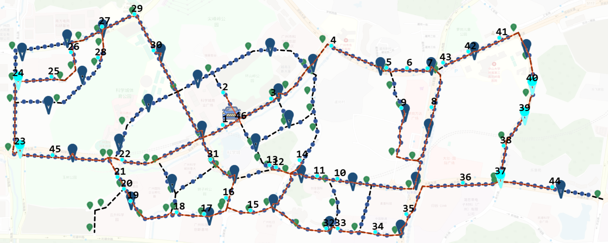
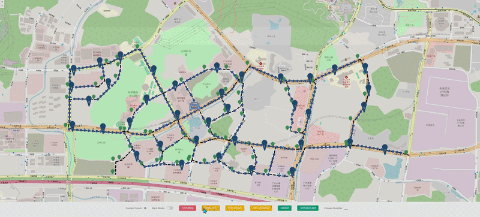

# RAWCS: Road-Aware Wireless Charging Scheduling for Traffic Wireless Sensor Networks.
<!-- Add banner here -->


<p align="center">
  <sub>
    Built by
    <a href="https://github.com/drggboy">drggboy</a>,
    <a href="https://github.com/grtm77">grtm77</a>
  </sub>
</p>

<p align="center">
  <a href="" target="_blank">
    
  </a>
  <a href="" target="_blank">
    
  </a>
  <a href="" target="_blank">
    
  </a>
  <a href="https://www.python.org/downloads/release/python-3100/" target="_blank">
      
  </a>
  </br>
  <a href="https://github.com/drggboy/mytest_v2/releases" target="_blank">
    
  </a>

  <a href="https://github.com/drggboy/mytest_v2/commits/master" target="_blank">
    
  </a>

  <a href="https://github.com/drggboy/mytest_v2/graphs/contributors" target="_blank">
    
  </a>


  <a href="https://github.com/drggboy/mytest_v2/blob/master/LICENSE" target="_blank">
    
  <a/>
</p>
<hr>

<!-- Remove this note if you plan to copy this README -->


# Table of Contents
- [Relay Node Deployment System for Traffic Wireless Sensor Networks](#relay-node-deployment-system-for-traffic-wireless-sensor-networks)
- [Table of Contents](#table-of-contents)
- [Demo](#demo)
- [Usage](#usage)
- [Environment Configuration](#environment-configuration)
  - [Runtime environment](#runtime-environment)
    - [Docker](#docker)
  - [Development environment](#development-environment)
    - [Database Configuration](#database-configuration)
- [Deployment steps](#deployment-steps)
- [Directory Structure Description](#directory-structure-description)
- [Contributors](#contributors)
- [License](#license)
- [Citation](#citation)
- [Contact Information](#contact-information)

# Demo

<!-- Add a demo for your project -->

This system is an experimental platform for relay node deployment of traffic wireless sensor networks . It can be used to evaluate the implementation effect of the relay node deployment algorithm in actual traffic scenarios. Relay node deployment of traffic wireless sensor networks consists of two key steps: roadside sensor node coordinate collection and relay node optimal deployment location calculation. This system provides 4 test datasets that can be used for testing. You can also use the mark mode in the system to mark node coordinates for relay node calculations.





# Usage
If you only need to run this project for traffic wireless sensor network relay node deployment, then only need to configure [runtime environment](#runtime-environment)。You can download the version that does not include the matlab algorithm in the release. After downloading, execute the following code to deploy the gateway by accessing `localhost:8082`.
```sh
java xxx.jar -ak xxxxx
```

This project supports calling python algorithm for calculation, but needs to configure the [python runtime environment]().


# Environment Configuration
## Runtime environment
* JRE 1.8
* python 3.10

### Docker
For deploying applications, Docker can be utilized. The Docker configuration should match the following:
* Docker version: 27.3.1

To deploy the application, navigate to the project's root directory and execute the following command in your terminal:
``` sh
docker-compose up
```
This command pulls the required images from Docker Hub based on the `docker-compose.yml` file and deploys the application. Once the deployment is complete, the service can be accessed through a web browser at`localhost:8082`

## Development environment
If you need to modify the back-end code or modify the front-end page, you need to configure the following environment
* Java Version: Temurin JDK 1.8
* Node.js Version：v16.15.1
* npm Version：9.6.5
* vite Version: 4.4.4

### Database Configuration
To configure the database for the project, modify the `application.properties` file within the `src/main/resources` directory with the following details:
```properties
spring.datasource.url=jdbc:mysql://<db-host>:<port>/<database-name>
spring.datasource.username=<db-username>
spring.datasource.password=<db-password>
```
Replace \<db-host>, \<port>, \<database-name>, \<db-username>, and \<db-password> with your actual database settings. Ensure that your MySQL server is running and accessible at the provided URL and port. The database should be set up with the necessary tables and permissions for the user specified.

The code currently uses the `Marks2` database in the local database by default, with the following account and password configuration:
```properties
spring.datasource.url=jdbc:mysql://${DB_HOST:localhost}:3306/Marks2?serverTimezone=UTC&useUnicode=true&characterEncoding=utf8&useSSL=false&allowPublicKeyRetrieval=true
spring.datasource.username=${DB_USERNAME:road_data}
spring.datasource.password=${DB_PASSWORD:123456}
```
You can create a new database locally according to the above configuration, and initialize the tables in the database through the `road_data.sql` file to complete the database configuration.

# Deployment steps

Clone this repository and navigate inside the project root folder.

If you want to modify the style of the front end, please enter the project root directory, and then execute the following code.
```sh
cd ./vue
npm install
```
After installing the dependencies, you can modify the front-end related code in `./System/vue/src/App.vue`, and then execute the following command to view the front-end interface.
```sh
npm run dev
```

# Directory Structure Description
```sh
|-- Algorithm  // Core RAWCS algorithm (python)
|-- DataSet 
|-- images 
|-- System  // Complete system code
|-- README.md     // help
```

# Contributors

Thanks goes to these wonderful people ([emoji key](https://allcontributors.org/docs/en/emoji-key)):

<!-- ALL-CONTRIBUTORS-LIST:START - Do not remove or modify this section -->
<!-- prettier-ignore-start -->
<!-- markdownlint-disable -->
<table>
  <tbody>
    <tr>
      <td align="center" valign="top" width="14.28%"><a href="https://github.com/drggboy"><br /><sub><b>drggboy</b></sub></a><br /><a href="https://github.com/grtm77/mytest_v2/commits?author=drggboy" title="Code">💻</a> <a href="https://github.com/grtm77/mytest_v2/commits?author=drggboy" title="Documentation">📖</a></td>
      <td align="center" valign="top" width="14.28%"><a href="https://github.com/grtm77"><br /><sub><b>grtm77</b></sub></a><br /><a href="https://github.com/grtm77/mytest_v2/commits?author=grtm77" title="Code">💻</a> <a href="https://github.com/grtm77/mytest_v2/commits?author=grtm77" title="Documentation">📖</a></td>
    </tr>
  </tbody>
  <tfoot>
    <tr>
      <td align="center" size="13px" colspan="7">
        
          <a href="https://all-contributors.js.org/docs/en/bot/usage">Add your contributions</a>
        </img>
      </td>
    </tr>
  </tfoot>
</table>

<!-- markdownlint-restore -->
<!-- prettier-ignore-end -->

<!-- ALL-CONTRIBUTORS-LIST:END -->

This project follows the [all-contributors](https://github.com/all-contributors/all-contributors) specification. Contributions of any kind welcome!


# License
[MIT](./LICENSE) license.

# Citation
If you integrate or utilize the datasets provided through our web service in your research or projects, we kindly ask that you acknowledge our contribution by citing the following:

> RAWCS: Road-Aware Wireless Charging Scheduling for Traffic Wireless Sensor Networks.


# Contact Information
If you have any inquiries or require further assistance regarding the dataset, please feel free to contact us.

<!-- [(Back to top)](#目录) -->


